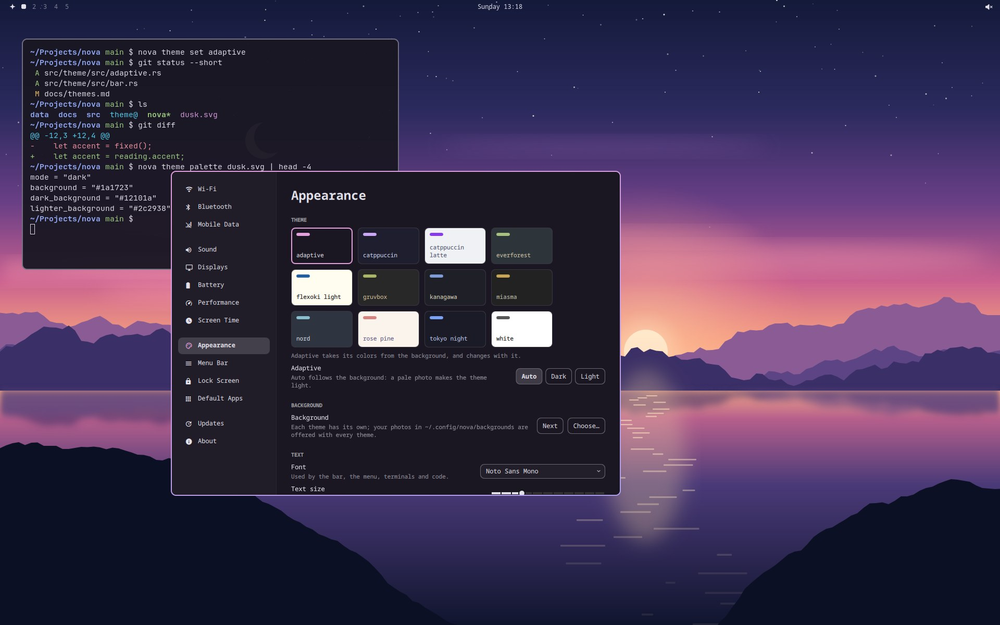
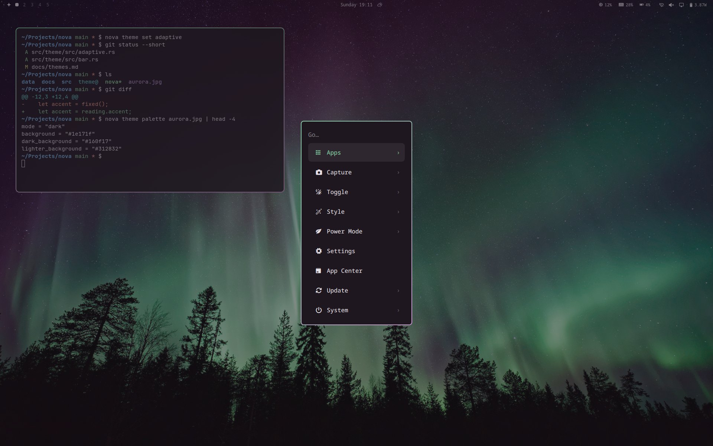

# Nova



Nova is an Arch Linux desktop for x86-64 laptops and desktop PCs. It is Hyprland, a shell of its own, one `nova` command and a power manager, installed together from a USB stick.

## What you get

- **The firmware logo, then the lock screen**, with no console text in between.
- **One theme everywhere**: the bar, the terminal, GTK and Qt apps, VS Code and Chrome change together. The adaptive theme takes its colors from your background.
- **One menu for everything** on Super+Space: apps, screenshots, toggles, themes, Settings, updates.
- **Settings** for Wi-Fi, Bluetooth, sound, displays, the battery, performance, the look, the bar, the lock screen and updates.
- **A calendar** of events and tasks, kept in one file on your computer.
- **Dictation**: hold Super+D and speak. It runs on your computer, and the speech model, 669 MB, is downloaded once, at the first use.
- **AirDrop**: an iPhone sends photos and files to the computer, with nothing to install on it. The Wi-Fi is off the network for the seconds that takes.
- **A release every two weeks**, tested before you get it, with a snapshot before each update to go back to.
- **An installer stick** that can carry your files over, install without internet, or hold a whole Nova to start any PC from.

## What it runs on

- Any 64-bit PC (x86-64) that starts with UEFI and has a disk of 64 GiB or more for Nova to take. Secure Boot must be off.
- Tuned in depth for the Lenovo ThinkPad P1 Gen 4i, where every release is tried before it is out.
- [Hardware support](docs/hardware.md) says what other laptops and desktops get, and how a fault of one computer is fixed.

## Install

1. **Download** from the newest [release](https://github.com/Andre-cmd-rgb/nova/releases): `nova-usb` on an Arch-based system, or the ISO on any other.
2. **Make the stick.** With `nova-usb`, run `sudo pacman -S gum`, then `bash nova-usb`: it fetches the ISO, checks it against Nova's signing key and writes the stick. Otherwise, write the ISO as it is with `dd` or any USB writer.
3. **Turn Secure Boot off** in the computer's firmware settings; the installer stops and says how when it is still on. If Windows stays on the computer and uses BitLocker or Device Encryption, it asks for its recovery key at its next start: have the key at hand first.
4. **Start the computer from the stick** (F12 at power-on on most computers, F9, F11 or Esc on some) and answer the questions. Nothing touches the disk until you type `erase`.
5. **Take the stick out and restart.** The computer starts into the lock screen.

The [install guide](docs/install.md) has the rest: each question, encryption, the offline stick, carrying files over, and a portable Nova on a USB drive.

## Keys worth knowing

| Key | Does |
|---|---|
| Super+Space | the menu |
| Super+Alt+Space | the apps |
| Super+Return | a terminal |
| Super+Shift+Return | the browser |
| Super+Shift+F | Files |
| Super+W | close the window (windows have no title-bar buttons) |
| Super+1 to Super+0 | workspaces 1 to 10 |
| Super+Ctrl+L | lock |
| Super+D | dictation: hold and speak, or tap for hands-free |
| Print | a screenshot |
| Super+K | every key, searchable |

[Using Nova](docs/using.md) has every key, the menu, Settings page by page, and the rest of the desktop.

<p>


</p>

## Updates and going back

- A notification says when a release is out, and a badge stays in the bar until it is installed.
- Settings → Updates, or `nova update` in a terminal, installs it with one password or fingerprint.
- Every update takes a snapshot first. When something is wrong after one, `nova recovery` restarts into the boot menu, whose **Snapshots** start the system as it was.
- Snapshots hold the system, not your files in `/home`: going back never touches them, and nothing backs them up either.

[Updates](docs/updates.md) has how releases are made, release candidates, and going back step by step.

## When something goes wrong

- `nova doctor` looks the system over and says how to fix what it finds. `nova doctor --bundle`, or Settings' **Save a Report**, writes one file to attach to a bug report, with your account's name, the computer's, addresses and serial numbers masked.
- `nova recovery` restarts into the boot menu: the last snapshots, the fallback image and the LTS kernel.
- An install that stops says at which step, and keeps its log in `/var/log/nova-install.log`.

[When something goes wrong](docs/updates.md#when-something-goes-wrong) has more. A fault of your one computer, such as a bad memory cell or a device that needs a quirk, is fixed with a [patch](docs/patches.md).

## Working on Nova

```sh
make lint                              # shellcheck, luac, qmllint, actionlint, the name check
make test                              # the unit tests (side by side with GNU parallel installed)
cargo test                             # the Rust parts
make DESTDIR=/tmp/nova-root install    # the nova package's files, into a scratch root
```

Packages and ISOs are built only by CI. Start with [the architecture](docs/ARCHITECTURE.md), the contract every component follows; [the documentation's index](docs/README.md) lists the rest.

The pictures are of the shell itself, taken by `tools/screenshots` over a background drawn for them (`docs/images/dusk.svg`, by `tools/draw-dusk`). They are taken off-screen on a Hyprland of their own, with Nova's look and window rules, so the windows are drawn as Nova draws them; they float, to leave the background in view, where Nova tiles them.

## License

MIT, see [LICENSE](LICENSE). [NOTICE](NOTICE) has the licenses of the code Nova builds on.
