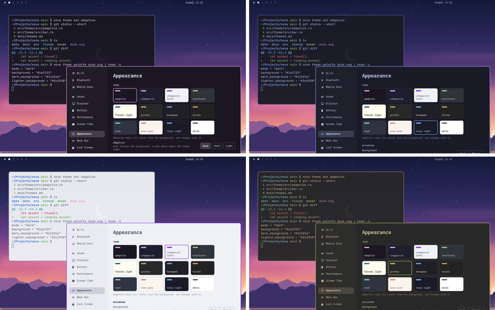

# Themes and backgrounds

This page covers choosing a theme, the adaptive theme that takes its colors from your background, backgrounds, the see-through bar and terminal, the font and text size, and making a theme of your own.



## Choosing a theme

Pick one in Settings → Appearance. The same choice is in the menu's Style → Theme, on Super+Shift+Ctrl+Space, and in a terminal:

```sh
nova theme list          # the themes installed
nova theme set nord      # use one
nova theme current       # the one in use
```

Nova comes with `adaptive`, `catppuccin`, `catppuccin-latte`, `everforest`, `flexoki-light`, `gruvbox`, `kanagawa`, `miasma`, `nord`, `rose-pine`, `tokyo-night` and `white`. A new account starts in `white`.

A theme reaches every part of the desktop at once:

- the shell: the bar, menu, panels, notifications and lock screen;
- Hyprland's window borders;
- apps: GTK 4 and libadwaita, GTK 3 and Qt, in its colors, light or dark;
- foot, open windows included;
- btop, VS Code, Claude Code and T3 Code;
- Chrome: its toolbar, and light or dark;
- the login screen after a logout.

Nothing before the lock screen is themed: the boot menu keeps its own colors.

### Apps

- **GTK 4 and libadwaita apps** (Files, Image Viewer and most new apps) take the theme's colors as they start.
- **GTK 3 apps** look like libadwaita's, in the theme's colors: Nova draws them with `adw-gtk3`.
- **Qt apps** take the colors through GTK 3, in Qt's own style.
- **Flatpak apps** get the same. A GTK 3 one draws with Flathub's `org.gtk.Gtk3theme.adw-gtk3` or `adw-gtk3-dark`, whichever the theme in use calls for, which Flatpak fetches with the next update (`nova update`) or install; until then, it is plain Adwaita.
- **X11 apps** (XWayland) get the theme, icons, cursor and font too.
- **Apps that draw themselves**, such as Flutter apps (LocalSend), Electron apps, slicers and Java apps, follow light or dark at most, in their own colors.

**When the theme changes**, foot, the shell, Chrome and VS Code change at once. An open GTK 4 or libadwaita app follows a change between light and dark at once, in libadwaita's own colors, and has the new theme's colors when it is opened again. An open GTK 3 or Qt app keeps the theme it started with until it is opened again.

`~/.config/gtk-3.0/gtk.css` and `gtk-4.0/gtk.css` are links to `nova.css` beside them, rewritten on each theme change. To add CSS of your own, replace a link with a file of yours that starts with `@import url("nova.css");`.

## The adaptive theme

The adaptive theme takes its colors from your background, and changes with it.

- **What the photo gives**: the tint of the surfaces and the text, the accent, the window border's two colors, how vivid the terminal's colors are, and whether the theme is dark or light.
- **What it keeps**: how light each color is comes from its role, not the photo, so text reads on its surface whatever the photo is, and the terminal's red stays red.
- **It sits with the photo**: the surfaces carry only a little of the photo's color, so the photo stays the colorful thing on the screen. Where the accent is near the surfaces' hue, as a dusk's pink is near its blue, the accent comes out between the two, a mauve rather than the loudest pink; a color across from it, as an orange sun is from blue water, keeps its own hue. The selection is a deeper shade of the surfaces.
- **A pale photo gives a light theme.** To keep it dark or light whatever the photo, set Settings → Appearance → **Adaptive theme**, shown while an adaptive theme is in use, to Dark or Light. Auto follows the background again.
- **With no photo**, on the wordmark, it has colors of its own, and the wordmark is drawn in them.

The same from a terminal:

```sh
nova theme set adaptive
nova theme adaptive              # auto, dark or light: the choice in use
nova theme adaptive dark         # keep it dark; auto follows the photo again
nova theme palette photo.jpg     # the palette a photo gives, changing nothing
nova theme palette photo.jpg light
```

The Auto, Dark or Light choice is kept in `~/.local/state/nova/adaptive`. It holds for every adaptive theme, over the `adaptive = "…"` line in the theme's own `colors.toml`.

## Backgrounds

Every theme offers:

- the wordmark, drawn in its colors, and any backgrounds the theme brings;
- your photos for that theme alone, in `~/.config/nova/backgrounds/<theme>/`;
- your photos in `~/.config/nova/backgrounds/`, which every theme offers.

Change it in Settings → Appearance (**Next** or **Choose…**), in the menu's Style → Background, on Super+Ctrl+Space, or in a terminal:

```sh
nova theme bg next             # the next one
nova theme bg pick             # choose in the picker
nova theme bg set ~/photo.jpg  # this image
nova theme bg list             # what the theme in use offers
```

Each theme remembers its own pick. A photo picked from the shared folder also becomes the background of every theme that has no pick of its own.

## A see-through bar

Settings → Menu Bar → **Transparent** lets the background show through the bar. The menu's Style → Menu Bar → Transparent, a double click on an empty part of the bar, and `nova bar transparent true|false|toggle` do the same.

The bar stays readable on any photo:

- its text takes whichever of the theme's two colors, the text's or the background's, reads on the photo under it;
- over a dark sky, that is all;
- where the photo is bright or busy, a soft shade of the other color sits behind the text, and fades out below it rather than ending in a line.

## A see-through terminal

The terminal's background is a fifth see-through, over a blur of what is behind it, and its text stays solid. Hyprland blurs behind terminals and nothing else. For a solid terminal, add this to `~/.config/foot/foot.ini`:

```ini
[colors-dark]
alpha=1.0
```

Super+Backspace makes any other window solid, or see-through again; it does not reach a terminal's own background.

## Font and text size

- **Font**: Settings → Appearance → Font picks the monospace font the bar, the menu, terminals and code use. In a terminal, `nova font list`, `nova font current` and `nova font set "<family>"`.
- **Text size**: Settings → Appearance → Text size, 9 to 20 px, scales text in the shell, apps and terminals. In a terminal, `nova display text size <px>`, or `reset`.

## Making or changing a theme

A theme is a folder with a `colors.toml`: flat `key = "value"` lines, one color each. It may also bring files ready-made:

| File | What it is |
|---|---|
| `colors.toml` | the palette (required) |
| `shell.toml`, `shell.<section>.toml` | the shell's look, whole or one section of it |
| `icons.theme` | the icon set it was made with, used when that set is installed (Adwaita otherwise) |
| a per-app file, such as `foot.ini` or `hyprland.lua` | used instead of the file Nova renders for that app |
| `backgrounds/` | backgrounds the theme offers |

Nova's themes are in `/usr/share/nova/themes/`. A folder in `~/.config/nova/themes/` is a theme of yours:

- **with a new name**, a new theme;
- **with the name of one of Nova's**, it changes that theme file by file: a `colors.toml` of yours replaces Nova's, and the rest stays Nova's.

To start one from a copy:

```sh
mkdir -p ~/.config/nova/themes
cp -r /usr/share/nova/themes/nord ~/.config/nova/themes/my-theme
nova theme set my-theme
```

Then edit `~/.config/nova/themes/my-theme/colors.toml`, and run `nova theme set my-theme` again. `nova theme color <key>` reads one color of the theme in use, and `nova theme color --all` all of them.

Your own templates go in `~/.config/nova/templates/` as `<file>.tpl`, and are rendered with the palette before Nova's of the same name. Nova's are in `/usr/share/nova/templates/`.

A session starts with `nova theme refresh`, which renders the theme in use again when a template or a theme file has changed since it was set: an update of Nova's reaches your theme without picking it again. Run it yourself after editing a template.

### A theme from someone else

A palette is safe: its values may hold only hex colors, `rgb()`, words, numbers and a few separators, so a `colors.toml` cannot put code into the files it is rendered into.

The files a theme brings ready-made are used as they are, and some of them are code: Hyprland runs a `hyprland.lua`, and a `foot.ini` can set the terminal's shell. **A theme with more than a palette is a program.** Install one only from someone you trust.

Theming never needs root.
