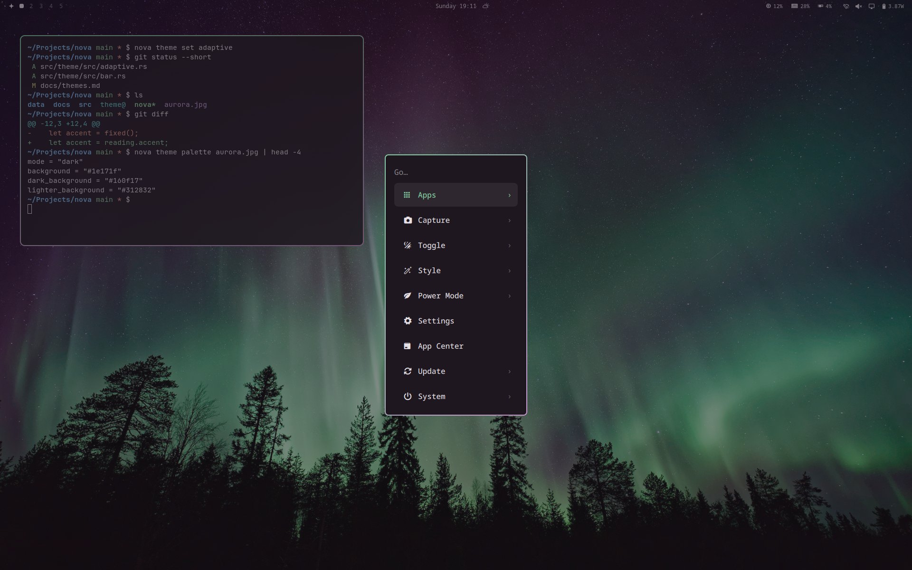
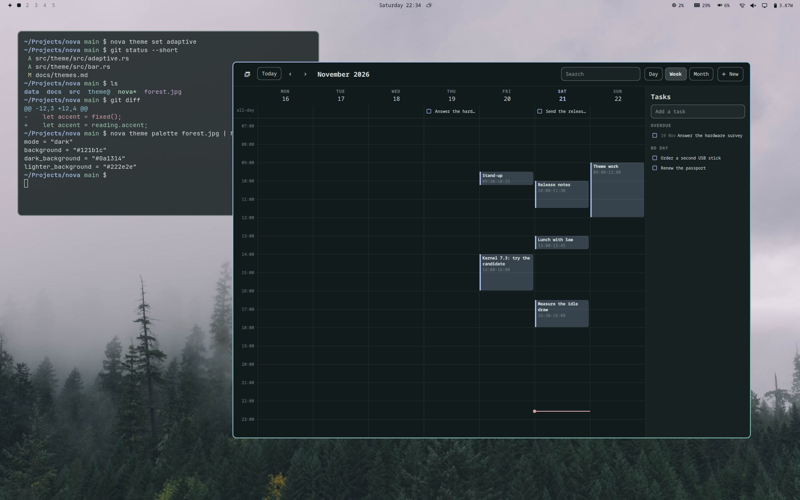

# Using Nova

The desktop day to day: the first minutes, the menu, the bar, Settings and the apps that come with Nova. Every key and command is in [Keys and commands](keys.md).

## New to a tiling desktop?

Nova runs on Hyprland, a tiling window manager. Sixty seconds of how it works:

- **Windows tile.** A new window takes its share of the screen beside the others, rather than piling on top. Super+T lets one float, as on other desktops; Super+drag moves it, Super+right-drag resizes it.
- **Windows have no title-bar buttons.** Super+W closes the window you are in.
- **Workspaces are your desks.** Super+1 to Super+0 go to desk 1 to 10, and Super+Shift with a number takes the window along. The numbers at the left of the bar are the desks in use. On a touchpad, three fingers sideways go to the next one.
- **Super+Space is the way in.** Type the name of an app, a setting ("wifi", "dark mode"), or a sum, and press Return.
- **Super+K lists every key**, searchable, and runs the one you pick.
- **Super+Return** opens a terminal, **Super+Shift+B** the browser, **Super+Shift+F** Files.

Super is the key with the Windows logo.

## The first minutes

- The computer starts into the lock screen. The first unlock after a start takes your password; after that a fingerprint works too, if you enrolled one.
- The welcome comes after the first unlock, one page each for what the installer could not set: Wi-Fi when there is no connection, the theme, the night light, VS Code when the computer was installed offline and is online now, and the few keys worth learning. Closing it ends it; `nova welcome` opens it again.
- `nova help` lists every command, and `nova help <group>` one group's.

## The menu



Super+Space opens it. Type to search, or go down the list:

| Entry | Holds |
|---|---|
| Apps | the installed apps (Super+Alt+Space opens it here) |
| Capture | screenshot, screen recording (with or without sound), text by OCR, a color off the screen, emoji |
| Toggle | Caffeine, Do Not Disturb, Night Light, AirDrop, Screen Time, the bar, window gaps; the laptop display and touchpad where there is one |
| Style | theme, background, font, a see-through bar |
| Power Mode | the battery's power modes, where the computer has them |
| Settings, App Center | open them |
| Update | Nova and firmware updates, restarting a part of the desktop, the time zone, your password |
| System | lock, suspend, hibernate, log out, restart, restart to recovery, shut down; the last four ask first |

A search finds more than the entries:

- **Settings' pages**, by name or by a word for what is on them: volume, trackpad, dark mode.
- **A sum or a conversion**: `2*(3+4)`, `15% of 80`, `5 km in miles`, `72 f in c`. The answer is the first row: Return copies it, Ctrl+Return opens it in the Calculator. Currencies are left out, as their rates would need the network.

It finds no files and no apps that are not installed: the [App Center](apps.md) does those.

Entries of your own go in `~/.config/nova/menu.jsonc`, laid over Nova's (`/usr/share/nova/default/menu.jsonc`) entry by entry, a field at a time.

## The bar

The bar is along the top. From the left: the menu's star and the workspaces; in the middle the clock, the keyboard layout, the weather and the update badge; on the right the tray, Bluetooth, mobile data, the network, sound and power. A widget shows only where it applies.

- **Click** a widget for its panel; right-click the star for a terminal.
- **Drag** a widget to move it. **Double-click** an empty part for a [see-through bar](themes.md#a-see-through-bar).
- **Settings → Menu Bar** switches the optional widgets: the weather (on at first), media, microphone, the active window, CPU, graphics, memory and Screen Time.
- **Tray icons**: right-click one for its menu, which ends with **Quit**: it ends the app for good, background processes and all. To hide an icon, switch it off in Settings → Menu Bar.
- `nova bar remove <id>`, `nova bar put <id>` and `nova bar defaults` change the rest. The bar's [own notes](../src/shell/plugins/bar/README.md) list every widget.

## Settings

Open it from the menu, or with `nova settings <page>`. A page shows only where the computer has what it needs (a Wi-Fi card, a battery, a modem).

| Page | What is on it | `nova settings` |
|---|---|---|
| Wi-Fi | the radio, networks, and the connection's address, band and DNS | `wifi` |
| Bluetooth | the radio, Bluetooth Low Energy, [iPhone notifications](iphone.md), devices | `bluetooth` |
| Mobile Data | on or off, the SIM's PIN, signal and data used | `mobile-data` |
| AirDrop | letting your iPhone switch [AirDrop](airdrop.md) on | `airdrop` |
| Notifications | [Do Not Disturb](#do-not-disturb) and its hours | `notifications` |
| Sound | outputs, inputs, volumes | `sound` |
| Displays | resolution, refresh rate, scale, rotation, arrangement; the [night light](#night-light) | `displays` |
| Keyboard & Mouse | layouts, key repeat, pointer speed, scrolling, tap to click | `keyboard` |
| Dictation | the speech model, the last dictation, your spellings | `dictation` |
| Printers | printers, their queues and ink; Add Printer | `printers` |
| Battery | measured battery life, health, charge limit, the lid and the power button | `battery` |
| Performance | the power mode, the discrete GPU, the undervolt | `performance` |
| Screen Time | where your time went, per app; `nova screentime forget <app>` deletes one app's | `screentime` |
| Appearance | theme, background, font, text size ([themes](themes.md)) | `appearance` |
| Menu Bar | see-through, optional widgets, which tray icons show | `bar` |
| Lock Screen | password, waits before the screensaver and the lock, fingerprints | `lock` |
| Default Apps | browser, code editor, terminal | `apps` |
| Updates | updates, firmware, release candidates, Check for problems, a bug report | `updates` |
| About | the version and the computer | `about` |

A change of display settings goes back by itself after 15 seconds unless you keep it.

## Everyday

### Calendar



Events and tasks by day, week or month: from the clock's card, or `nova calendar [day|week|month] [date]` (`2026-10-29`, `tomorrow`, `next friday`).

- Drag an event to move it, its bottom edge to change its end, or across empty hours to make one. Tasks go onto a day, a time or the list beside.
- **Add Account** syncs with iCloud (with an app-specific password) or any CalDAV server, both ways, offline edits included; an iCal link can be subscribed to, read-only. Google sign-in is not available yet.
- Reminders come as notifications. Keys: arrows step, T is today, D, W and M the view, N a new event, / searches.

Your calendar is a file, `~/.local/share/nova/calendar/calendar.ics`. More in the calendar's [own notes](../src/shell/plugins/calendar/README.md).

### Dictation

Hold Super+D and speak; the words are pasted where the cursor is when you let go. A tap instead listens until the next press, up to ten minutes. Esc cancels until the words are pasted.

- It runs on your computer's CPU, with NVIDIA's Parakeet model, in 25 European languages. Nothing you say leaves it.
- The speech model, 669 MB, is downloaded once: the first Super+D offers it, the next downloads it. It stays in memory (700 to 800 MB) for two minutes after you dictate.
- Fillers ("uh", "um") are left out, a stumbled word is written once, and "scratch that" takes back the words since the last comma or full stop.
- The words stay on the clipboard in place of what it held, but out of its history; `nova dictation last` prints them again.
- Words it writes another way go in your spellings (`nova dictation vocab`), a line each: `"hyper land" = "Hyprland"`.

### Calculator and Quick Look

- **Calculator**: in the menu, on a keyboard's Calculator key, or `nova calculator [sum]`. Basic or scientific, with the last 100 sums.
- **Quick Look**: Space on a file in Files shows it in a window of its own: a picture, a PDF's first page, a video's first frame, the start of a text. The arrows go to the next file, Return opens it, Space or Esc closes.

### Screenshots and the clipboard

- **Print** freezes the screen: click a window, or drag a region. Return takes the window under the pointer, Ctrl+Return the whole screen, Esc gives up.
- **Alt+Print** records the screen; again to stop. **Super+Print** picks a color.
- **Super+C, V and X** copy, paste and cut in any window, a terminal too. **Super+Ctrl+V** brings back something copied earlier.

### The terminal

Super+Return opens foot, with bash.

- **The prompt** is the folder: `~/Projects $`. In a git repository it adds the branch (or the commit, when none is checked out) and git's marks, `*` changed, `+` staged, `%` new files: `~/Projects/nova main *+ $`. After a command that failed it shows its status, `exit 1`, and after one that took 5 seconds or more, how long, `took 12s` (`NOVA_PROMPT_LONG=10` in `~/.bashrc` makes that 10).
- **The Up and Down arrows** find the earlier commands that start with what you have typed; on an empty line they go through the history as before. Ctrl+R searches it. A command is in the history as soon as it starts, so a terminal opened meanwhile finds it.
- **Tab** ignores case, lists the choices at the first press when there are several, and marks each: `/` a folder, `*` a program, `@` a link. A small typo in a folder's name is put right, by Tab and by `cd`.
- **A slow repository** (a very large one, or one on a network share): after two prompts that took over half a second to find its changes, the prompt stops marking them there and says so. `git config bash.showDirtyState false` keeps `*` and `+` off in it for good, `git config bash.showUntrackedFiles false` the `%`.
- Nova's settings for bash are in `/usr/share/nova/default/bash/bashrc`, which your `~/.bashrc` reads first: what you add after that line wins, and updates improve the rest. A `~/.bashrc` of your own gets them with this line at its top; take out a `PS1` of your own to have Nova's prompt:

```bash
[[ -r /usr/share/nova/default/bash/bashrc ]] && . /usr/share/nova/default/bash/bashrc
```

### Caffeine

Caffeine keeps the screen on: no screensaver, no lock, and on a laptop a closed lid only turns the panel off. Super+Ctrl+I, the menu's Toggle, or `nova caffeine toggle` (`on`, `off`; alone, it says whether it is on). It lasts until you turn it off or log out, and on battery until the battery is down to 10%.

### Night light

A warmer screen for the evening: Super+Ctrl+N or the menu's Toggle. Settings → Displays turns it on from sunset to sunrise (reckoned on the computer, from the time zone's city or the weather's place) or at set hours, and sets its warmth. `nova nightlight schedule sunset`, or `nova nightlight schedule 22:00 07:00`, does the same, and `nova nightlight warmth 3400` sets the warmth, from 2500 K, the warmest, to 5500 K.

### Do Not Disturb

Notifications go to the history (Super+Shift+Alt+comma) instead of the screen. Super+Ctrl+comma or the menu's Toggle; Settings → Notifications, or `nova notification schedule 22:00 07:00`, holds it at set hours every day. An urgent notification a script sends (`notify-send -u critical`) still shows; an app's waits in the history like the rest.

### Screensaver and lock

After three minutes unused the screensaver plays the wordmark in your theme's colors; after five the screen locks. Settings → Lock Screen changes both. A `~/.config/nova/screensaver.txt` is played instead of the wordmark. An app that asks to keep the screen awake (a video call, a film) holds both off.

### Printing

Settings → Printers. A modern USB or network printer needs no setting up; an older one is added with Add Printer. A printer out of paper or ink says so in a notification while it prints.

## Apps that come with Nova

| App | For |
|---|---|
| Supernova | the web: Nova's own browser, in the theme's colors (Firefox instead, if you chose it) |
| VS Code | code (installed once the computer is online) |
| Files (Nautilus) | files, phones, cameras, network shares |
| foot | the terminal |
| Loupe, mpv | photos; video and music |
| btop | Activity: what is running (Super+Ctrl+T) |
| Claude Code, Codex | coding agents in the terminal, through `mise` |

- The installer asks which browser you want, when online: Supernova, Firefox or Chrome. Settings → Default Apps changes it, and the editor and terminal.
- The [App Center](apps.md) installs the rest.
- A crashed app is said in a notification, with Reopen.
- A variable your login profile sets (`~/.bash_profile`, `~/.profile`) holds for the whole desktop from the next login. So does a token or a password exported there: every app can read it, so keep those in the file the tool that needs them reads.

## Keyboard and languages

- **Caps Lock is the Compose key**: Compose, `'`, `e` types é. **Both Shifts together** are Caps Lock.
- **Layouts**: Settings → Keyboard & Mouse adds up to four and the keys that switch them. A layout without Latin letters comes second to US, so shortcuts keep working.
- The login screen types in the layout chosen at install; the lock screen in the one in use.
- Nova is in English. Chinese, Japanese and Korean text needs `sudo pacman -S noto-fonts-cjk`, and has no input method yet.

More: [AirDrop](airdrop.md#sending) for photos and files from and to an iPhone, [iPhone notifications](iphone.md), and [power and battery](power.md).
